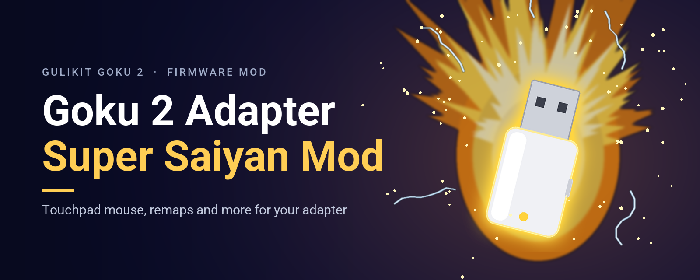
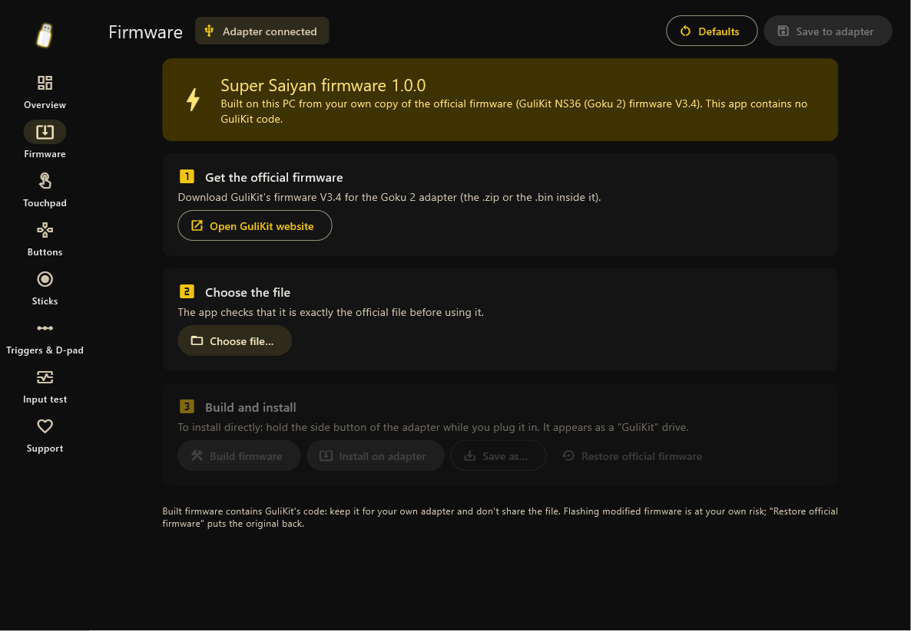
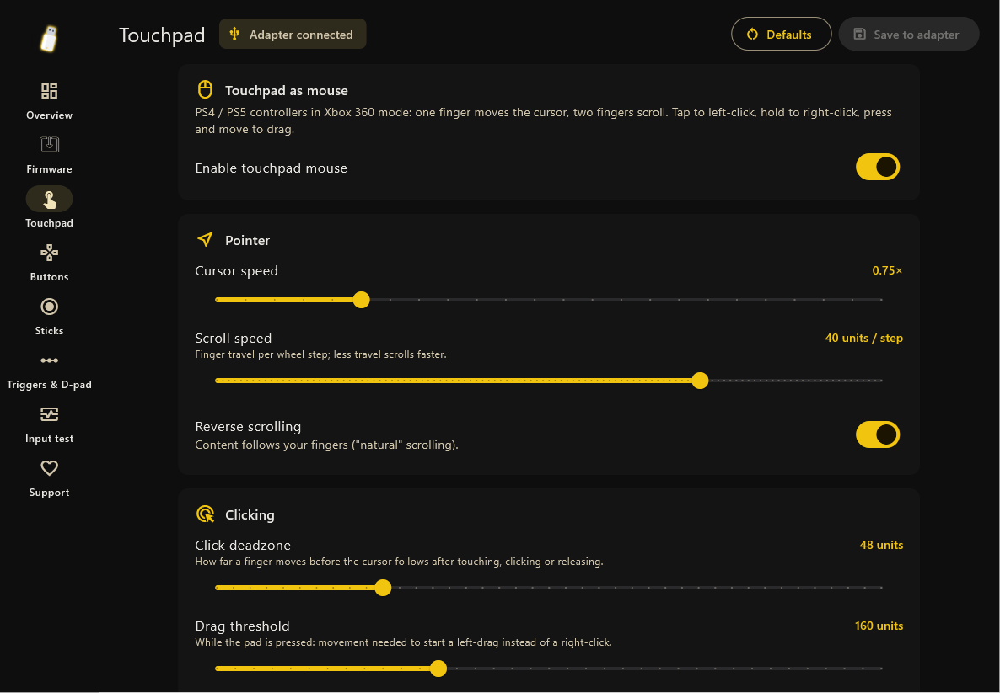
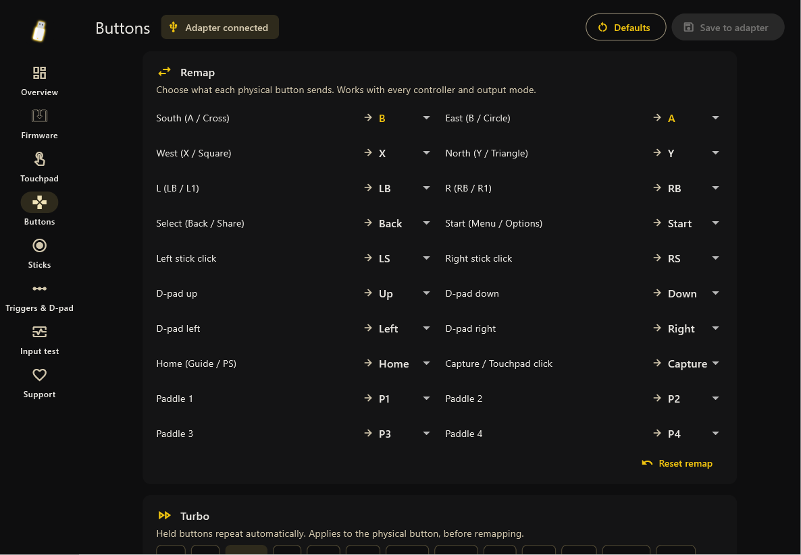
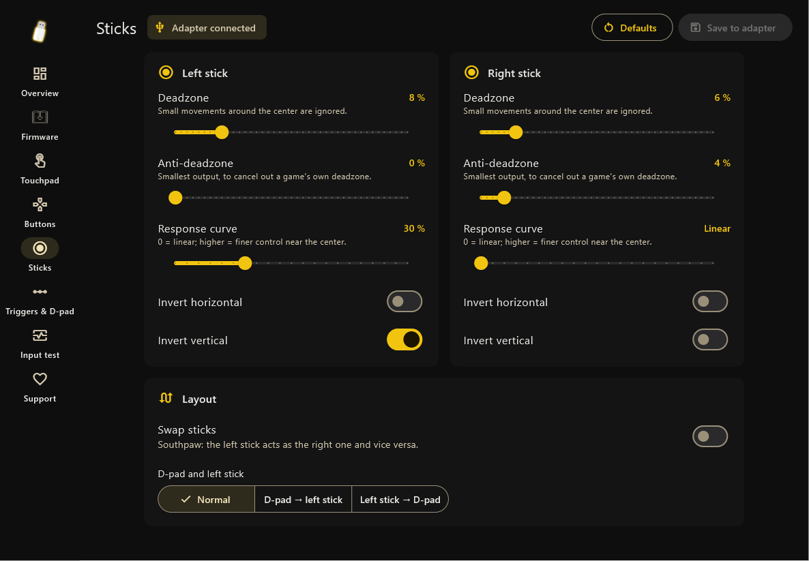
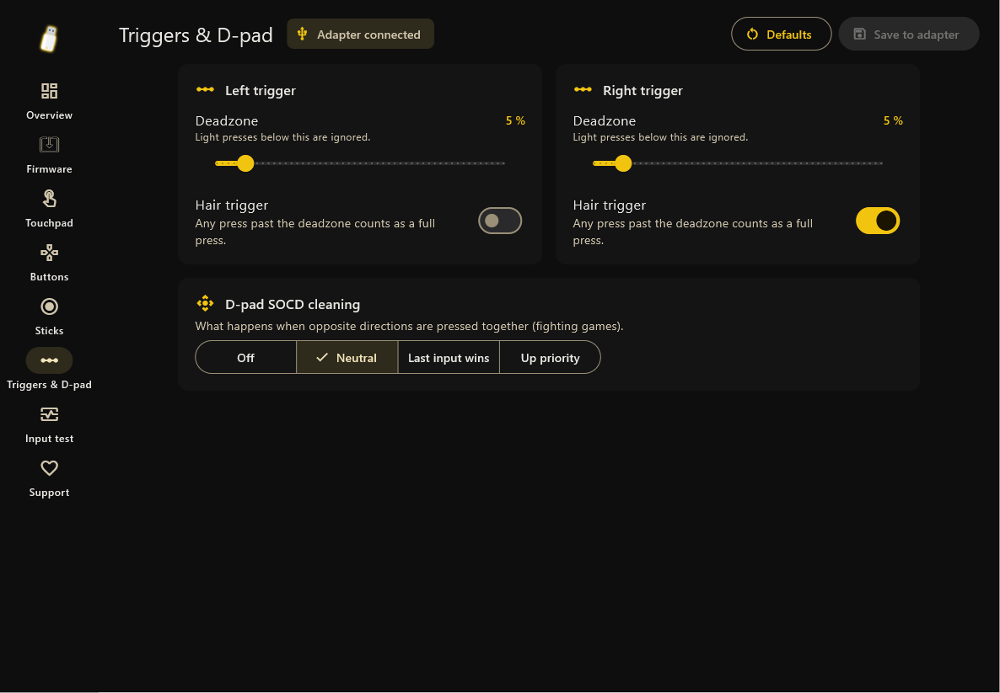
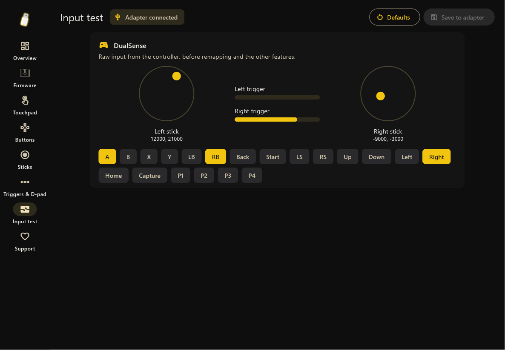

# Goku 2 Adapter Super Saiyan Mod

[](https://ko-fi.com/denarmo)
[](LICENSE)

Power up your **GuliKit Goku 2 Wireless Controller Adapter** (internal name **NS36**)
with new features, configured from a companion app. The app builds the modded firmware
on your PC from **your own copy** of GuliKit's official firmware: this project contains
and distributes no GuliKit code. Unofficial community project, not affiliated with GuliKit.

> [!NOTE]
> **AI disclosure:** this project (firmware mod, tools and app) was written with AI
> assistance (Claude by Anthropic) and tested on real hardware. If you prefer to avoid
> AI-coded products, this one isn't for you.

## Features

All features run inside the adapter, so they work on any console or PC. Settings are
saved in the adapter itself.

| | |
|---|---|
| **Touchpad as mouse** | A DualShock 4 / DualSense touchpad becomes a PC mouse while the adapter runs in Xbox 360 mode, next to the normal gamepad. One finger moves the cursor, two fingers scroll, tap to left-click, hold to right-click, press and move to drag. Speed, scroll speed, reverse scrolling, click deadzone, drag threshold and right-click hold time are adjustable. |
| **Button remapping** | Any button to any other button (or off), on every controller and output mode. |
| **Turbo** | Rapid fire on any button, 2–30 presses per second. |
| **Toggle (latch)** | Tap once to hold a button down, tap again to release. |
| **Stick tuning** | Per stick: deadzone, anti-deadzone, response curve, axis inversion. Swap sticks (southpaw), D-pad ↔ left stick. |
| **Trigger tuning** | Per trigger: deadzone and hair trigger. |
| **SOCD cleaning** | D-pad: neutral, last input wins or up priority (fighting games). |

### Companion app

A Material You (Material 3) desktop app for Windows. It builds and installs the
firmware, then configures every feature live; settings are saved in the adapter. It
follows your accent colour and light/dark mode.

| | |
|---|---|
|  |  |
|  |  |
|  |  |

## Install

1. Download the **Super Saiyan Companion** from Releases, unzip it and run
   `super_saiyan_companion.exe`. No drivers needed.
2. Download GuliKit's official **firmware V3.4** for the Goku 2 adapter (the `.zip`) from
   [GuliKit's download page](https://www.gulikit.com/newsinfo/3196031.html).
3. In the app, open **Firmware**: choose the official file (the app checks it is exactly
   V3.4), press **Build firmware**, then hold the adapter's side button while plugging it
   in and press **Install on adapter**. Replug it when done.
4. Put the adapter in **Xbox 360 mode**: the app connects and every setting is available.

"Restore official firmware" on the same page puts GuliKit's original back. Flashing
modified firmware is at your own risk.

> **Don't share built firmware.** A built image contains GuliKit's code, so it is theirs to
> distribute, not ours or yours. Share the app or this repository instead.

`tools/ss_cli.py` does the configuration from the command line (`info`, `get`, `set`, `save`, `live`).

## Under the hood

- **Decompiled (locally):** the reverse-engineering knowledge for all code in the update
  file, for both processors on the receiver: the ARM Cortex-M main MCU (Bluetooth host,
  controller drivers, USB device) and the WCH RISC-V USB-host co-processor. That's 1,124
  named functions, recorded in `reference/` as addresses, names, types and notes. The
  pseudo-C itself is GuliKit-derived, so it isn't hosted: `tools/decompile.sh`
  regenerates it with Ghidra from your own firmware file (see "Working from source").
- **Readable:** the right load address and memory map, reconstructed RAM, named ROM
  calls, recovered types (`cntlr_state_t`, config block), named subsystems, peripheral
  register names, and a module map. See [docs/architecture.md](docs/architecture.md).
- **Extensible:** a mod SDK compiles your C code into the firmware and hooks it into
  boot, controller input, USB requests and output. modkit packs mod code into the main
  free flash plus ~3.6 KB reclaimed from the vendor's debug-log strings. Tested in an
  emulator that runs the firmware's real boot code, and on real hardware. See
  [docs/modding.md](docs/modding.md).
- **How the app talks to the adapter:** in Xbox 360 mode the firmware enumerates as a
  composite device (`1209:0001`). Interface 0 stays the Xbox pad (a Microsoft OS descriptor
  makes Windows load its Xbox driver), and interface 1 is a HID device carrying the mouse and
  a vendor feature report for configuration. Settings are stored next to the vendor config
  in flash. Details: `mods/super_saiyan/`.

> **Status:** firmware 1.0.0 is verified on real hardware with a DualSense: the touchpad mouse,
> settings applied live and kept across power cycles, the Xbox 360 and PS5 modes. See
> [docs/hardware-observations.md](docs/hardware-observations.md) and
> [the testing notes](docs/modding.md#testing-on-hardware--read-first) before flashing
> your own builds.

## Working from source

Everything here needs your own copy of the official firmware at `firmware/NS36_V3.4.bin`
(git-ignored; never commit it).

```bash
# 1. inspect the official image
python tools/ns36fw.py info firmware/NS36_V3.4.bin

# 2. regenerate the readable decompilation locally (-> src/*/decompiled/, git-ignored)
GHIDRA_INSTALL_DIR=/path/to/ghidra bash tools/decompile.sh

# 3. build and test the firmware (mods with "enabled": true; super_saiyan is on)
python tools/modkit.py build            # -> build/NS36_mod.bin
python tools/emu_test.py build/NS36_mod.bin
python tools/test_super_saiyan.py build/NS36_mod.bin

# 4. turn the build into the app's patch (our code only) and build the app
python tools/make_patch.py firmware/NS36_V3.4.bin build/NS36_mod.bin app/assets/firmware_patch.json 1.0.0
cd app && flutter build windows --release && cd ..
```

`make`, `make mods`, `make test` and `make decompile` wrap the same commands.

## Repository layout

| Path | What |
|---|---|
| `firmware/` | Put your official `NS36_V3.4.bin` here (git-ignored) |
| `src/*/decompiled/` | Pseudo-C generated locally by `tools/decompile.sh` (git-ignored) |
| `src/ghidra_types.h` | Typedefs so the pseudo-C is IDE-friendly |
| `reference/` | **The RE knowledge base:** names, prototypes, types, globals, module map, reclaimable flash |
| `mods/` | Mod SDK (`include/ns36.h`), runtime, and `super_saiyan` (the release firmware features) |
| `app/` | Companion app (Flutter, Material 3, Windows) |
| `tools/ns36fw.py` | Update-file `info` / `unpack` / `pack` / `build` (JSON byte patches) |
| `tools/modkit.py` | Builds mods into a flashable image |
| `tools/emu_test.py`, `tools/test_*.py` | Unicorn-based boot, hook and feature tests |
| `tools/find_reclaimable.py` | Finds vendor log-string flash that mods can reuse |
| `tools/ss_cli.py` | Command-line client for the adapter's config channel |
| `tools/make_patch.py` | Turns a firmware build into the app's patch (no GuliKit bytes) |
| `tools/decompile.sh`, `tools/ghidra/` | Ghidra headless pipeline |
| `docs/` | Architecture, file format, modding guide, RE workflow |

## Feature map: where each Goku 2 feature lives

Find a feature here, open the function in your locally generated
`src/arm/decompiled/region_<addr & ~0x1FFF>.c`
(e.g. `0x1000FABC` is in `region_1000e000.c`), and change behavior with a mod hook
(`docs/modding.md`) rather than by editing generated code. **Confirmed** = traced in the
decompiled code or checked on hardware; *inferred* = located by log strings or call
context only.

### Input path (every controller, every output mode)

| Feature | Function(s) | Address | File | Status |
|---|---|---|---|---|
| Universal input entry: every driver submits a normalized `cntlr_state_t` here | `cntlr_submit_input` | `0x1001290C` | `region_10012000.c` | **confirmed**, hardware |
| Per-controller button layout → logical buttons → output bits | `buttons_to_protocol`, tables `0x1001C228` (per controller type), `0x1001C318` (per output mode) | `0x10012FCC` | `region_10012000.c` | **confirmed**, hardware |
| Stick calibration and deadzone | `stick_calibrate`, `switchpro_parse_state` | `0x10016ED4`, `0x1001A24C` | `region_10016000.c`, `region_1001a000.c` | **confirmed** |
| Send the finished report to the console/PC | `usb_send_input_report` | `0x10012A70` | `region_10012000.c` | **confirmed** |
| Mod hook points | `input_filter` at `0x10012976`, `report_filter` at `0x10012A14`, boot at `0x100041FE` | | | **confirmed**, hardware |

### Output modes (what the console sees)

| Mode | Encoder | Address | File | Status |
|---|---|---|---|---|
| Switch Pro (mode 1) | `out_encode_switchpro` → `out_encode_switchpro_report` | `0x1001A3F6` | `region_1001a000.c` | **confirmed** |
| Xbox 360, shows as "GuliKit X" `045E:028E` (mode 2) | `out_encode_xbox` | `0x1001B176` | `region_1001a000.c` | **confirmed**, hardware |
| Xbox One / GIP (mode 3) | `out_encode_xbox` | `0x1001B176` | `region_1001a000.c` | **confirmed** |
| PS4 DualShock 4 (mode 4) | `out_encode_ps4` | `0x10016298` | `region_10016000.c` | **confirmed** |
| PS5 DualSense `054C:0CE6` (mode 5) | `out_encode_ps5` | `0x10016C0C` | `region_10016000.c` | **confirmed**, hardware |
| Switch 2 Pro (mode 6) | `out_encode_switch2` | `0x100191AC` | `region_10018000.c` | **confirmed** |
| Current mode variable | `g_output_mode` | `0x2000D318` (RAM) | | **confirmed** |
| Fake DualSense MAC (feature report `0x09`) | `g_ps5_fake_mac` | `0x2000CDD6` (RAM) | | **confirmed**, hardware |
| Switch Pro emulation toward the console (sub-commands: player lights, IMU enable, SPI-flash reads/writes) | `sum_cmd` | `0x1001947C` | `region_10018000.c` | *inferred* |

### Supported controllers (input drivers)

| Controller | Function(s) | Address | File | Status |
|---|---|---|---|---|
| Switch Pro / Switch 2 Pro (reports, calibration, IMU) | `switchpro_in_report`, `switchpro_parse_state`, `switch_cal`, `switch2_in_process` | `0x10019D20`, `0x1001A24C`, `0x10019964`, `0x10018DD8` | `region_10018000.c`, `region_1001a000.c` | **confirmed** |
| PS4 / PS5 (incl. Edge) | `ps_in_report`, `ps_parse_state`, `ps5_cntlr_conn_ind` | `0x100160CC`, `0x10016110`, `0x10016500` | `region_10016000.c` | *inferred* |
| Xbox Wireless / Elite 2 | `xbox_wireless_controller` + `bt_*` module | `0x1000F658` | `region_1000e000.c` | *inferred* |
| Wired controllers via the USB-host co-processor | MSP link `msp_uart_rx_poll`, `msp_uart_send_frame`; host side `src/msp/decompiled/` | `0x10014780`, `0x10014740` | `region_10014000.c` | **confirmed** framing |
| BT HID host (connect, service discovery, VID/PID) | `sdk_hid_host_cbk`, `sdk_set_conn` | `0x100182E8`, `0x10018988` | `region_10018000.c` | *inferred* |

### Adapter features

| Feature | Function(s) / data | Address | File | Status |
|---|---|---|---|---|
| Settings-button hotkeys (turbo per button, sensitivities) | `cntlr_settings_process` | `0x1000FABC` | `region_1000e000.c` | **confirmed** |
| Settings button enable/disable (hold 6 s, V2.7) and timed actions | `settings_timer_event` (logs `settings on/off`) | `0x1000E4B4` | `region_1000e000.c` | *inferred* |
| Turbo ("auto key") A/B/X/Y/R1/R2 | `g_config.turbo[6]` | `0x2000D5B8` (RAM) | | **confirmed** |
| Rumble / stick / trigger sensitivity | `g_config.rumble_sens`, `joys_sens_l/r`, `l2_sens`, `r2_sens` | `0x2000D5BE`–`0x2000D5C2` | | **confirmed** |
| Rear-button / paddle remapping ("study", V3.1) | `g_config.study[4]`; logical buttons `LB_PADDLE1..4` | `0x2000D5C4` | | *inferred* |
| Save configuration | `cntlr_save_config`, `cntlr_save_config_by_check` | `0x1000F304`, `0x1000F744` | `region_1000e000.c` | **confirmed** |
| Rumble passthrough / one-shot vibration feedback | `cntlr_rumble_once_to`, `rumble_once_on_going` | `0x100105B0`, `0x100106A8` | `region_10010000.c` | *inferred* |
| Controller pairing / discovery state machine | `IM_INQ`, `IM_INQUIRY` (`cntlr_enter_discovery_mode`), `IM_WAIT`, `IM_DISC`, `IM_UPDATE`, `cntlr_conn_ind` | `0x1000F100`–`0x1000F634` | `region_1000e000.c` | *inferred* |
| Bonded-device storage | `smp_bondcount` | `0x100181C8` | `region_10018000.c` | *inferred* |
| USB device side (enumeration, descriptors, reset) | `usb_set_config`, `usb_set_interface`, `hid_get_descriptor`, `usb_reinit` | `0x1001ABAC`, `0x1001AD74`, `0x100127A8`, `0x10012E9C` | `region_1001a000.c`, `region_10012000.c` | *inferred* |
| Reboot into update/other mode (warm-boot mailbox) | `g_boot_mailbox` `AA mode ~mode 55`, `app_system_reset` | `0x2000FFFC`, `0x1000E3BC` | `region_1000e000.c` | **confirmed** |

For the full subsystem layout see the module map in [docs/architecture.md](docs/architecture.md).

## Contributing

Every function has a name, but ~860 of them are subsystem tags (`bt_hci_10007044`)
rather than descriptive names. Replacing tags with real names is the main remaining
work, together with
answering the open questions in
[docs/reverse-engineering.md](docs/reverse-engineering.md#open-questions-good-first-issues),
especially decoding the four unknown header words. Record findings in `reference/`,
regenerate, and send a PR. Hardware test reports are very welcome.

## License and legal

Copyright © Denarmo and contributors. Licensed under
[Creative Commons Attribution-NonCommercial-ShareAlike 4.0](LICENSE) (CC BY-NC-SA 4.0):

- **You may** use, share and fork this project, and change it, as long as you credit it,
  keep it free (no commercial use, no selling, no paid or ad-supported versions) and
  release your changes under the same license.
- **You may not** include, host or distribute GuliKit's firmware, firmware built with this
  project, or code decompiled from it. Those contain GuliKit's copyrighted code; no license
  here covers them.

Not affiliated with or endorsed by GuliKit. "GuliKit" and "Goku" are their trademarks,
used only to describe compatibility. Flashing modified firmware is at your own risk.

If you like the project, you can [support it on Ko-fi](https://ko-fi.com/denarmo).
